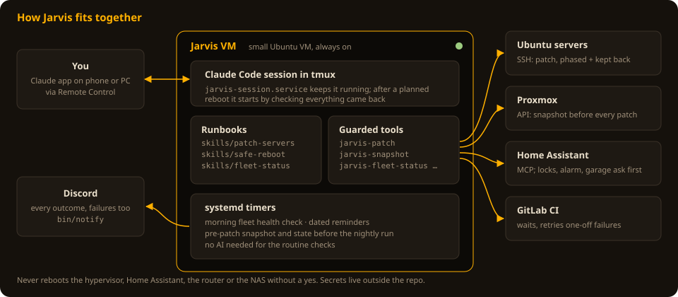

<h1 align="center">Jarvis</h1>

  <b>An always-on Claude Code agent that runs my homelab, and the guardrails that keep it safe.</b> 
  It patches servers after taking a snapshot, checks the fleet every morning, talks to Home Assistant, 
  and reports every outcome to Discord. These are the real scripts, systemd units and runbooks it uses.

  
  
  
  
  

  <a href="https://jackwent.co.uk/jarvis-ai-assistant-runs-my-homelab/"><b>Read the story: Jarvis, the AI that runs my homelab</b></a> ·
  <a href="#guardrails-that-make-it-safe-to-leave-running">Guardrails</a> ·
  <a href="#adapting-it">Adapt it</a>

  

Giving an AI a root shell and hoping for the best is easy. Jarvis does it differently. It's a [Claude Code](https://claude.com/claude-code) session that lives on a small VM, does its work through a handful of **purpose-built scripts with guardrails** instead of raw commands, follows **written runbooks**, and reports **every outcome** to Discord. I reach it from the Claude app on my phone or PC with Remote Control.

This repo is a cleaned-up copy of what it runs on. Hostnames, addresses and personal details are replaced with generic names, so treat it as a **starting point to adapt**, not something to run as it is.

## What it does day to day

| When | What | How |
| --- | --- | --- |
| 07:30 daily | Morning fleet health check: pending updates, reboots needed, disk, failed units, Proxmox VMs, Home Assistant | `jarvis-fleet-status --notify` on a timer, no AI needed |
| 09:03 daily | Dated one-off reminders, caught up if Jarvis was off on the day | `jarvis-remind` on a timer |
| 23:45 nightly | Gets ready for its own VM's patch run: saves what's worth keeping, then snapshots itself | `jarvis-autopatch-prep` |
| On request | Patches servers: snapshot, phased and kept-back updates, health check, notify, then delete the snapshot | the `patch-servers` runbook |
| On request | Reboots safely: confirm, snapshot, leave a note, verify everything came back | the `safe-reboot` runbook |
| After a reboot | Starts by checking the reboot went well and reports, instead of sitting idle | `jarvis-session` reads `state/pending-reboot.md` |
| When shipping code | Waits for the GitLab pipeline and retries a job once if it hit a one-off network error | `jarvis-ci-wait` |

## How it fits together

- **The session:** `jarvis-session` starts Claude Code inside tmux on a small Ubuntu VM. A systemd service keeps it running, and Claude's Remote Control makes it reachable from the Claude app on a phone or PC.
- **The tools:** small scripts the session calls instead of typing raw commands, so each action has guardrails. For example, `jarvis-snapshot` can only delete snapshots whose names start with `jarvis-`.
- **The runbooks:** `skills/` holds step-by-step instructions the assistant follows for patching, rebooting and fleet checks.
- **The timers:** systemd timers run the daily health check, the reminders and the pre-patch preparation as plain scripts.

## What's here

| Path | What it does |
| --- | --- |
| `bin/notify` | Sends a message or a coloured status card to a Discord channel through a webhook |
| `bin/jarvis-fleet-status` | Read-only health check of every server: pending updates, reboots needed, disk, failed units, Proxmox VMs, Home Assistant |
| `bin/jarvis-patch` | Updates one known server over SSH, forces phased updates and installs kept-back packages. It never reboots |
| `bin/jarvis-snapshot` | Proxmox snapshots per server; only ever deletes snapshots it created itself |
| `bin/jarvis-ci-wait` | Waits for a GitLab pipeline and retries a job once if it failed on a one-off network error |
| `bin/jarvis-autopatch-prep`, `bin/jarvis-pre-reboot` | Save state and take a snapshot before the nightly patch run, and leave a note if a reboot happens |
| `bin/jarvis-remind` | Dated one-off reminders sent to Discord |
| `bin/jarvis-session` | Starts the Claude Code session with Remote Control, and the post-reboot check when one is due |
| `skills/` | Runbooks: `fleet-status`, `patch-servers`, `safe-reboot` |
| `systemd/` | Services and timers for the session, health check, reminders and pre-patch preparation |
| `hardening/cis-ubuntu-safe.sh` | A cautious subset of CIS Ubuntu hardening that won't lock you out |

## Guardrails that make it safe to leave running

- Always snapshot or back up before patching anything.
- Never reboot the hypervisor, Home Assistant, the router or the NAS without explicit confirmation, given in the same session.
- Locks, alarms and garage doors always need a yes.
- If a reboot would take the assistant itself offline, it writes down what to check first and reports back when it returns.
- Every maintenance job posts its outcome, successes and failures alike.
- Secrets live outside the repo.

## Adapting it

Edit the host lists at the top of `jarvis-fleet-status`, `jarvis-patch` and `jarvis-snapshot`, add your Discord webhook for `notify`, and point the runbooks in `skills/` at your own servers. The scripts assume SSH key access to each server and the Proxmox API for snapshots. Copy `bin/` to `/usr/local/bin`, the units in `systemd/` to `/etc/systemd/system`, and enable the timers you want.

## Related

- [Jarvis-AI-Desktop](https://github.com/JackWent/Jarvis-AI-Desktop): a 2.5 MB Tauri (Rust) Windows tray app that my family uses to talk to Jarvis.
- [Ubuntu-Auto-Update](https://github.com/JackWent/Ubuntu-Auto-Update): the nightly patch script Jarvis's own VM runs.
- [HA-MQTT-Agent](https://github.com/JackWent/HA-MQTT-Agent): puts every server in Home Assistant. Jarvis checks its *Agent Online* sensors after a reboot.
- The write-up: [Jarvis, the AI that runs my homelab](https://jackwent.co.uk/jarvis-ai-assistant-runs-my-homelab/).

## Licence

Released under the MIT licence. See [LICENSE](LICENSE).
